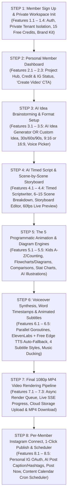
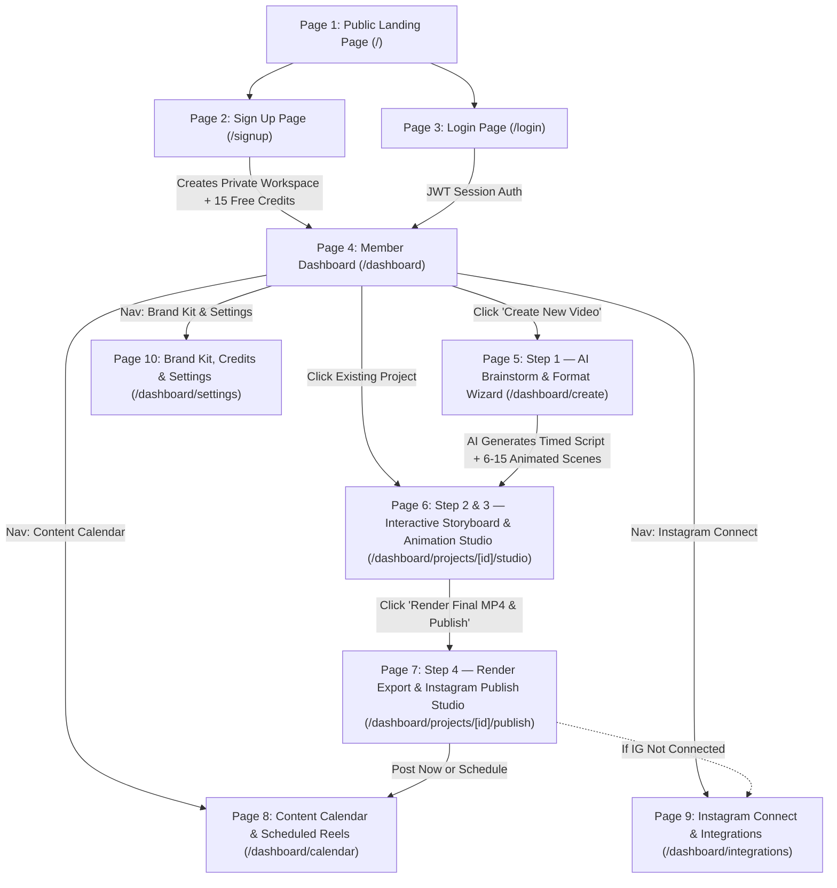
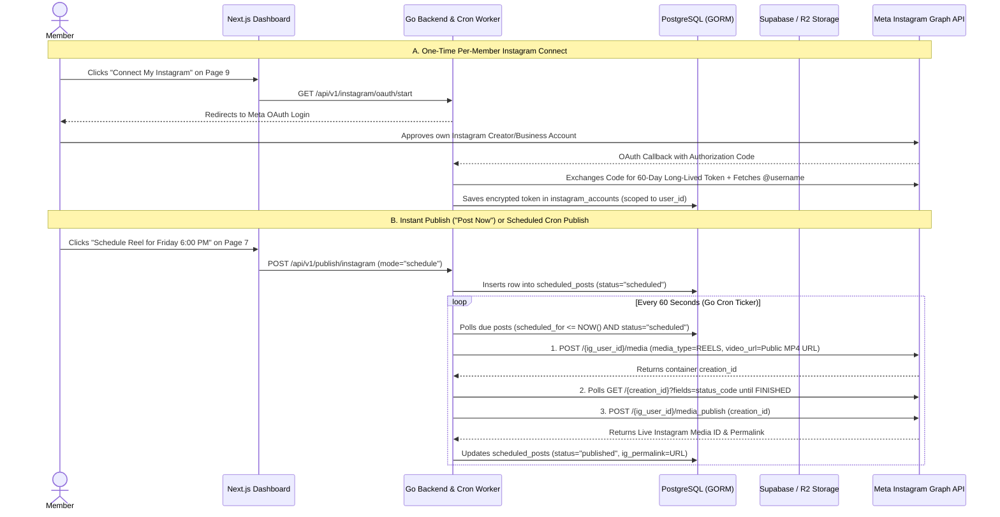
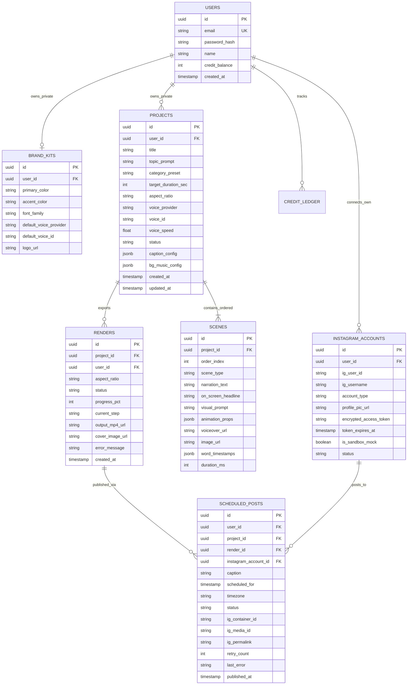

# Product Requirements Document (PRD): Animora Studio
**Product Name:** Animora Studio — AI Educational & Animated Video SaaS Platform  
**Version:** 1.0 (Complete Feature, Page-by-Page Flow & Technical Specification)  
**Target Stack:** Next.js (TypeScript + Tailwind + Framer Motion) • Remotion (5-Template Animation Engine) • Go (Golang) Backend • PostgreSQL (`GORM`) • Free-Tier AI & Cloud Stack ($0/month)

---

## 1. Detailed Product Overview: What We Are Building

### 1.1 The Big Picture
**Animora Studio** is a multi-tenant Software-as-a-Service (SaaS) web platform where **any creator, educator, kids' learning channel, or brand marketer** can sign up for their own private account, brainstorm video ideas with AI, generate a complete **30-second, 60-second, or 90-second animated educational/explainer video** (complete with AI voiceover, programmatic animations, diagrams, kids' A-to-Z/counting animations, and word-by-word animated subtitles) in either **9:16 Vertical (Instagram Reels / Shorts)** or **16:9 Landscape (YouTube / Courses)**, and **publish or schedule it directly to their own Instagram account** with one click.

### 1.2 Core Problems Animora Studio Solves
Today, if an educator or creator wants to make and post a 60-second animated explainer Reel, they must manually use 5 to 6 separate tools:
1. **ChatGPT** to brainstorm a topic and write a timed script.
2. **ElevenLabs or a mic** to record a voiceover.
3. **After Effects / Canva / Midjourney** to create flowcharts, diagrams, or kids' counting/alphabet animations.
4. **CapCut / Premiere Pro** to sync the voiceover, add background music, and generate word-by-word subtitles.
5. **Buffer / Meta Business Suite** to write an Instagram caption, add hashtags, and schedule the Reel.

**Animora Studio replaces all 5 tools with one unified pipeline inside a single dashboard.**

### 1.3 Strict Multi-Tenant SaaS Model (Every Member Has Their Own Dashboard & Own Instagram)
* **Isolated Member Accounts:** Every person who signs up on Animora Studio gets their own isolated account (`user_id`), their own private Dashboard, their own saved Video Projects, their own Brand Kit, and their own Credit Balance.
* **Per-Member Instagram Account Connection:** There is **no shared Instagram account**. Each member connects **their own** Instagram Creator or Business account inside their dashboard via "Instagram Connect" (Meta OAuth). When Member A hits "Post Now" or schedules a video, it posts strictly to Member A's Instagram account (`@member_a`). When Member B logs in, Member B only sees their own videos and posts strictly to Member B's Instagram account (`@member_b`).

---

## 2. Step-by-Step Product Flow & Master Feature List ("What Happens First ➔ What Feature We Build Next")

Below is the exact chronological flow of **Animora Studio** from the moment a user arrives to the moment their animated video is published on Instagram, listing **all 33 features** we are building at each stage:

### Step 1 ➔ First: Member Onboarding & Private Workspace Setup
* **What happens in the flow:** A user visits Animora Studio, creates an account (or logs in), and the system automatically provisions their private workspace, starter credits, and default Brand Kit.
* **Features we have to build for Step 1:**
  * **Feature 1.1 — Member Sign Up & Login:** Email/Password authentication (`bcrypt` + JWT HTTP-only session cookie) and Google OAuth login.
  * **Feature 1.2 — Private Multi-Tenant Workspace Isolation:** Strict per-member data isolation (`WHERE user_id = ?`) so every member has their own private dashboard, videos, and social connections.
  * **Feature 1.3 — Starter Credit Grant:** Automatically grants **15 Free Video Credits** to every new member upon registration.
  * **Feature 1.4 — Personal Brand Kit Configuration:** Saves the member's default primary/accent colors, font family, watermark logo, and default voiceover engine/persona so all their videos stay consistently branded.

### Step 2 ➔ Next: Member Lands on Their Personal Dashboard & Clicks "Create Video"
* **What happens in the flow:** Immediately after logging in, the member sees their personal dashboard showing their past videos, scheduled Instagram posts, remaining credits, and a prominent **"Create New AI Video"** button.
* **Features we have to build for Step 2:**
  * **Feature 2.1 — Personal Project Dashboard:** Displays all video projects belonging to the member with live status badges (*Draft Storyboard*, *Generating Assets*, *MP4 Ready*, *Scheduled*, *Published on Instagram*).
  * **Feature 2.2 — Quick-Start Category Shortcuts:** 1-click launch buttons for *Educational Explainer*, *Kids Learning (A–Z & Counting)*, and *Myth vs. Fact Reel*.
  * **Feature 2.3 — Project Management Actions:** Open project in Studio, download rendered MP4, duplicate project, or delete project.

### Step 3 ➔ Next: AI Idea Brainstorming & Video Format Configuration
* **What happens in the flow:** After clicking "Create Video", the member first brainstorms the video concept with AI (or types their own idea) and chooses the video duration (`30s`, `60s`, `90s`), aspect ratio (`9:16` or `16:9`), style preset, and voiceover persona.
* **Features we have to build for Step 3:**
  * **Feature 3.1 — "Ask AI for Ideas" Brainstormer:** Member enters a niche or subject (e.g., *"Finance for beginners"* or *"Preschool kids counting & alphabet"*) → **Gemini 2.5 Flash / Groq** generates **5 hook-driven video ideas** with titles, 3-second hooks, and visual concepts to choose from.
  * **Feature 3.2 — "Use My Own Idea" Input:** Member types their own custom topic, lesson notes, or prompt (e.g., *"Explain how photosynthesis works with a 4-step diagram"* or *"Teach kids A is for Apple and count 1 to 5 stars"*).
  * **Feature 3.3 — Target Duration Selector (`30s`, `60s`, or `90s`):** Lets the member pick a 30-second, 60-second, or 90-second video (up to 1m 30s).
  * **Feature 3.4 — Dual Aspect Ratio Selector (`9:16` & `16:9`):** Supports both **9:16 Vertical** (for Instagram Reels / YouTube Shorts) and **16:9 Landscape** (for YouTube / Classroom explainers).
  * **Feature 3.5 — Voiceover Engine Toggle & Voice Persona Picker:** Member toggles between **Free Edge Neural Voices ($0 Unlimited)** and **ElevenLabs Voices (Free Tier + Auto-Fallback)**, previews voice samples (*Kids voice Ana*, *Teacher voice Jenny*, *Explainer voices Christopher / Aria / Neerja*), and sets speaking speed (`0.85x`–`1.20x`).

### Step 4 ➔ Next: AI Generates the Timed Script & Scene-by-Scene Animated Storyboard
* **What happens in the flow:** The AI takes the chosen idea and duration, writes a complete voiceover script, splits it into **6 to 15 ordered scenes**, and opens the **Interactive Storyboard Studio** where the member can preview and edit every scene.
* **Features we have to build for Step 4:**
  * **Feature 4.1 — Duration-Calibrated AI Scriptwriter:** Writes a structured educational script (*Scroll-Stopping Hook → Clear Step-by-Step Explanation → Takeaway & Call-to-Action*) calibrated to exact spoken word counts (`~70 words` for 30s, `~150 words` for 60s, `~225 words` for 90s).
  * **Feature 4.2 — Automated Multi-Scene Storyboard Generator:** Enforces a strict JSON schema so the AI breaks the script into 6–15 scenes and automatically assigns the best **Animated Scene Type** and animation data to every scene.
  * **Feature 4.3 — Interactive Storyboard Editor:** Allows the member to edit any scene's voiceover script, change its on-screen headline, drag-and-drop scenes to reorder them (via Framer Motion), add new scenes, or delete scenes.
  * **Feature 4.4 — Live 60fps In-Browser Animation Preview (`@remotion/player`):** Plays the full animated video right inside the browser at 60fps and updates instantaneously whenever the member edits text, colors, diagrams, or switches between `9:16` and `16:9`.

### Step 5 ➔ Next: The 5 Programmatic Animation & Diagram Engines Render Each Scene
* **What happens in the flow:** Instead of showing static images, each scene in the video animates educational diagrams, flowcharts, kids' A-to-Z letters, counting objects, charts, or camera motion in sync with the voiceover.
* **Features we have to build for Step 5:**
  * **Feature 5.1 — Kids Alphabet (A–Z) & Counting (1–20) Animation Engine (`kids_counting` / `alphabet_card`):** Animates big bouncing 3D/spring letters (`A is for Apple`) or numbers (`1 to 10`), where objects/stickers (`🍎`, `⭐`, `🐶`) pop onto the screen **one-by-one at the exact millisecond the voiceover counts them**, finishing with a celebratory confetti burst.
  * **Feature 5.2 — Animated Diagram & Flowchart Engine (`diagram_flow`):** Animates 2 to 5 connected process nodes (`Step 1 ➔ Step 2 ➔ Step 3`) with SVG arrows drawing across the screen and active nodes glowing/pulsing as each step is explained.
  * **Feature 5.3 — Split Comparison Animation Engine (`split_comparison`):** Animates two contrasting cards sliding in with spring physics (*Myth vs. Fact*, *Do's vs. Don'ts*, *Old Way vs. New Way*) with animated `✗` and `✓` badges.
  * **Feature 5.4 — Animated Stat Counter & Bar Chart Engine (`stat_counter` / `bar_chart`):** Smoothly counts numbers up from `0` to the target stat (e.g., `0% ➔ 87%`) or animates multi-bar charts growing upward.
  * **Feature 5.5 — AI Illustrated Motion Engine (`illustrated_motion`):** Generates custom scene illustrations via **Pollinations Flux (100% Free)** in selectable art styles (*3D Pixar/Kids Storybook*, *Modern Flat Vector*, *Whiteboard*, *Dark Tech*) with smooth 60fps Ken Burns camera zoom/pan and floating keyword callout pills.

### Step 6 ➔ Next: Parallel Voiceover Synthesis, Word Timestamps & Animated Subtitles
* **What happens in the flow:** The Go backend spawns concurrent goroutines to generate the voiceover audio, word-level timestamps, and AI illustrations for all scenes in parallel, and overlays word-by-word animated captions and background music.
* **Features we have to build for Step 6:**
  * **Feature 6.1 — Concurrent Go Goroutine Asset Pipeline:** Generates voiceovers and visuals for all 6–15 scenes simultaneously in parallel so a 60s–90s video's assets finish in seconds.
  * **Feature 6.2 — Dual Voiceover Engine with Smart Auto-Fallback:** Synthesizes audio + millisecond word timestamps via either **ElevenLabs (`/with-timestamps`)** or **Free Edge Neural TTS (`WordBoundary`)**, automatically falling back to Free Edge Neural TTS if ElevenLabs hits its free monthly limit or blocks a cloud IP.
  * **Feature 6.3 — Burned-In Word-Synced Animated Captions (4 Styles):** Syncs on-screen subtitles word-by-word to the voiceover with 4 selectable presets:
    1. *Karaoke Word-Highlight* (active spoken word highlights in accent color & bounces)
    2. *Hormozi Pop* (bold uppercase chunks with colored pop-in pill behind active word)
    3. *Kids Read-Along Bounce* (large rounded font with a bouncing star/dot above each spoken word for early readers)
    4. *Clean Minimal Bar* (smooth bottom subtitle bar for 16:9 lessons)
    * Includes controls to toggle subtitles On/Off, change font, colors, and safe-zone vertical placement.
  * **Feature 6.4 — Background Music & Auto-Ducking Mixer:** Lets the member add background music that automatically lowers in volume (~12%) whenever the voiceover is speaking.
  * **Feature 6.5 — Single-Scene Re-Roll:** Lets the member regenerate the voiceover or AI illustration of just **one specific scene** without re-generating the rest of the video.

### Step 7 ➔ Next: Final 1080p MP4 Video Rendering & Export Pipeline
* **What happens in the flow:** Once the member approves the preview, they click **"Render Final MP4"**. The backend encodes the full 1080p H.264 `.mp4` video (`1080×1920` for 9:16 or `1920×1080` for 16:9) and uploads it to cloud storage.
* **Features we have to build for Step 7:**
  * **Feature 7.1 — Asynchronous Render Queue & Live SSE Progress Bar:** Streams live rendering stages (*1. Audio Sync → 2. Animation Composition → 3. Subtitle Burn-In → 4. MP4 Upload*) to the browser via Server-Sent Events (SSE).
  * **Feature 7.2 — Cloud Storage Upload & 1-Click MP4 Download:** Uploads the final `.mp4` and cover thumbnail to **Supabase Storage / Cloudflare R2** (generating the public HTTPS URL needed by Instagram) and provides a direct **"Download MP4"** button.
  * **Feature 7.3 — Credit Deduction Ledger:** Deducts credits only when rendering a final MP4 (`30s = 1 credit`, `60s = 2 credits`, `90s = 3 credits`) and logs the transaction in the member's credit history.

### Step 8 ➔ Finally: Per-Member Instagram Connect, 1-Click Auto-Post & Content Calendar Scheduler
* **What happens in the flow:** With the final MP4 ready, the member connects their own Instagram account (if not already connected), reviews the AI-generated Instagram post caption and hashtags, and either clicks **"Post to Instagram Now"** for instant publishing OR schedules it on the **Content Calendar** for automatic background publishing.
* **Features we have to build for Step 8:**
  * **Feature 8.1 — Per-Member "Instagram Connect" (Meta OAuth 2.0 + Sandbox Mode):** Allows each member to click **"Connect Instagram"** and link **their own personal Instagram Creator or Business account** via Meta OAuth (storing their encrypted 60-day token scoped strictly to their `user_id`), plus a built-in **Sandbox Mock Mode** for testing without waiting on Meta App Review.
  * **Feature 8.2 — AI Instagram Post Caption & Hashtag Generator:** Reads the video script and automatically writes an engaging Instagram Reel caption (Scroll-stopping hook + key takeaway bullets + engagement CTA + 8–12 niche hashtags) with a tone selector and 1-click AI rewrite.
  * **Feature 8.3 — Reel Cover / Thumbnail Picker:** Lets the member pick a video frame or title card as the Reel cover image.
  * **Feature 8.4 — 1-Click "Post to Instagram Now" Pipeline:** Executes the official Meta Instagram Graph API Reels publishing pipeline (`POST /{ig_user_id}/media` with `media_type=REELS` → polls container status until `FINISHED` → `POST /{ig_user_id}/media_publish`) and returns the live Instagram Reel permalink URL.
  * **Feature 8.5 — Automated Content Calendar & Go Cron Scheduler:** Lets the member pick any future Date, Time, and Timezone to schedule their Reel; a background Go cron worker wakes up every 60 seconds in PostgreSQL, automatically publishes due Reels to each member's connected Instagram account, retries on transient network errors, and updates the visual Content Calendar (*Scheduled → Publishing → Published Live*).

---

## 3. Complete Application Sitemap: How Many Pages & What Is On Every Page

Animora Studio consists of **10 Core Pages / Screens** organized into Public/Auth pages and the Protected Member Workspace.

### 2.1 Visual Page Navigation & User Flow Diagram

---

### 2.2 Detailed Page-by-Page Breakdown (All 10 Pages)

#### Page 1: Public Landing Page (`/`)
* **Purpose:** Convert visitors into signed-up members by showcasing what Animora Studio creates.
* **What is on this page:**
  * **Top Navbar:** Animora Studio Logo, Features link, Sample Videos link, Pricing/Free Tier info, `Login` button, and `Start Creating Free` CTA button.
  * **Hero Section:** Headline (*"From Rough Idea to Animated Educational Reel—Scheduled to Instagram in Minutes"*), interactive preview showcasing 3 live sample animations (*1. Technical Flowchart Explainer*, *2. Kids A-to-Z & Counting Animation*, *3. Myth vs. Fact Reel*).
  * **How It Works (4-Step Visual Pipeline):** *1. Brainstorm with AI → 2. Edit Animated Storyboard → 3. Auto-Voiceover & Subtitles → 4. 1-Click Instagram Schedule*.
  * **Pricing / Free Credits Banner:** Highlights that new members start free with 15 starter credits.

#### Page 2: Member Sign Up Page (`/signup`)
* **Purpose:** Register a new member and initialize their isolated SaaS workspace.
* **What is on this page:**
  * Sign-up form: **Full Name**, **Email Address**, **Password** (with strength indicator), and **"Continue with Google"** OAuth button.
  * **What happens on submit (Backend Flow):**
    1. Creates a new row in `users` with `credit_balance = 15` (free starter credits).
    2. Automatically creates a default row in `brand_kits` for this user (default modern colors, font, and free neural voice).
    3. Issues an HTTP-only JWT session cookie and redirects to `/dashboard`.

#### Page 3: Member Login Page (`/login`)
* **Purpose:** Authenticate returning members into their private dashboard.
* **What is on this page:**
  * Login form: **Email Address**, **Password**, **"Continue with Google"**, and **"Forgot Password"** flow.
  * Validates credentials against the Go backend (`POST /api/v1/auth/login`) and loads only that member's workspace.

#### Page 4: Personal Member Dashboard (`/dashboard`)
* **Purpose:** The member's command center showing their videos, credits, and Instagram schedule at a glance.
* **What is on this page:**
  * **Left Sidebar Navigation:**
    * `Dashboard` (`/dashboard`)
    * `+ Create Video` (`/dashboard/create`)
    * `Content Calendar` (`/dashboard/calendar`)
    * `Instagram Connect` (`/dashboard/integrations`)
    * `Brand Kit & Settings` (`/dashboard/settings`)
  * **Top Header Bar:** Member welcome greeting, **Credits Remaining Pill** (e.g., `⚡ 15 Credits`), **Instagram Connection Badge** (`🟢 Connected: @your_handle` or `⚪ Connect Instagram`), and Member Avatar menu.
  * **3 Quick Stat Cards:**
    1. *Total Videos Created*
    2. *Scheduled / Published Reels*
    3. *Available Video Credits*
  * **"Create New AI Video" Hero Action Banner:** Prominent button to start a new video, plus quick-start preset buttons (*"New Explainer Video"*, *"New Kids A-Z / Counting Video"*, *"New Myth vs. Fact Reel"*).
  * **My Recent Projects Grid:** Cards for every video created by this member, showing:
    * Thumbnail / Aspect ratio badge (`9:16` or `16:9`)
    * Duration badge (`30s`, `60s`, or `90s`)
    * Status badge (`Draft Storyboard`, `Generating Assets`, `Ready to Render`, `MP4 Ready`, `Scheduled for IG`, `Published on IG`)
    * Quick actions: *Open in Studio*, *Download MP4*, *Publish/Schedule*, *Duplicate*, or *Delete*.

#### Page 5: Step 1 — Create Video & AI Brainstorm Wizard (`/dashboard/create`)
* **Purpose:** Help the member go from either "I have no idea what to make today" OR "I have a rough topic" to a complete, timed, multi-scene animated storyboard.
* **What is on this page:**
  * **Step 1A — Choose Your Ideation Mode (2 Tabs):**
    * **Tab 1: "Ask AI to Brainstorm Ideas":**
      * Input field: *Enter your niche, subject, or target audience* (e.g., *"Personal finance for beginners"*, *"Preschool kids learning numbers 1 to 10 and A to Z"*, *"How Web3 / AI works"*).
      * Button: **"Generate 5 Video Ideas"** → Calls Gemini 2.5 Flash / Groq to return 5 clickable cards. Each card shows:
        * **Suggested Video Title**
        * **3-Second Opening Hook**
        * **Why It Works / Key Visual Concept**
      * Clicking any card selects it as the active video concept.
    * **Tab 2: "I Have My Own Idea / Topic":**
      * Textarea: Member types their exact topic, bullet points, or pastes lesson notes (e.g., *"Explain how photosynthesis works in 4 simple steps with a diagram"* or *"Teach kids A is for Apple, B is for Ball, C is for Cat and count 1 to 3"*).
  * **Step 1B — Configure Video Format & Style:**
    * **Target Duration Selector:**
      * `30 Seconds` (~65–75 words • 5–6 animated scenes • Costs 1 Credit)
      * `60 Seconds` (~140–155 words • 8–10 animated scenes • Costs 2 Credits)
      * `90 Seconds` (~210–230 words • 12–15 animated scenes • Costs 3 Credits)
    * **Aspect Ratio Selector:**
      * `9:16 Vertical (1080×1920)` — Best for Instagram Reels, Shorts, TikTok
      * `16:9 Landscape (1920×1080)` — Best for YouTube, Classroom/Course lessons
    * **Educational Style / Category Preset:**
      1. *Technical & Concept Explainer* (heavy on animated flowcharts, diagrams, and callouts)
      2. *Kids Learning, Alphabet (A–Z) & Counting (1–20)* (colorful bouncing letters/numbers, objects popping in one-by-one, playful voice pacing)
      3. *Myth vs. Fact / Comparison* (split-screen animated comparison cards)
      4. *Data, Stats & Listicle* (animated number counters, bar charts, top 3–5 lists)
      5. *Storybook / Illustrated Explainer* (AI illustrations with smooth camera motion & captions)
    * **Voiceover Engine & Persona Selector:**
      * **Voice Provider Toggle:** `Free Neural Voices (Unlimited $0)` vs. `ElevenLabs AI Voices (Free Tier + Auto-Fallback)`
      * **Voice Persona Dropdown (with Play Preview sample button):**
        * *Ana (Cheerful Kids / Early Learning Voice)*
        * *Jenny (Warm Teacher / Storyteller)*
        * *Christopher (Clear Documentary / Explainer Narrator)*
        * *Aria (Energetic Instagram Reels Creator)*
        * *Neerja / Prabhat (Clear Indian English Educator Voices)*
  * **Primary CTA Button:** **"Generate Script & Animated Storyboard ➔"** (Creates the project in PostgreSQL, generates the structured 6–15 scene JSON, and redirects to Page 6).

#### Page 6: Step 2 & 3 — Interactive Storyboard & Animation Studio (`/dashboard/projects/[id]/studio`)
* **Purpose:** The core creative workspace where the member reviews, edits, and previews their scene-by-scene script, voiceovers, animations, diagrams, and captions at 60fps before exporting the final MP4.
* **Layout (3-Column Studio Interface + Top Action Bar):**
  * **Top Studio Bar:**
    * Editable Project Title
    * Live Aspect Ratio Toggle (`9:16 Vertical` ↔ `16:9 Landscape` — clicking this immediately adapts the live video preview layout!)
    * Total Calculated Video Duration badge (e.g., `00:58 / 01:00 target`)
    * **"Generate All Voiceovers & Visuals"** button (runs parallel Go goroutines for all scenes with live percentage progress bar)
    * **"Render Final MP4 & Continue to Publish ➔"** button
  * **Left Column — Scene-by-Scene Storyboard Timeline:**
    * Vertical list of all scenes (`Scene 1: Hook`, `Scene 2: Step 1 Diagram`, `Scene 3: Counting 1 to 3`, ..., `Scene N: Summary & CTA`).
    * **Framer Motion Drag-and-Drop** to reorder scenes.
    * Each Scene Card displays: Scene number, Scene Type badge (`Flowchart`, `Kids Counting`, `Comparison`, `Chart/Stat`, `AI Illustration`), duration (`e.g., 5.2s`), narration snippet, and audio status icon (`✅ Voice Ready`).
    * Buttons at bottom: **`+ Add New Scene`** and **`Regenerate Full Script`**.
  * **Center Column — Live 60fps Interactive Video Preview (`@remotion/player`):**
    * Renders the actual React/SVG/Spring animations, AI illustrations, voiceover audio, background music, and word-by-word animated subtitles right inside the browser with **zero wait time**.
    * Timeline scrubber, Play/Pause, Mute, Loop, and Jump-to-Scene markers.
  * **Right Column — Scene & Global Inspector (3 Tabs):**
    * **Tab 1: Script & Voiceover (Per Scene)**
      * Editable **Narration Textbox** (edit what the voice says in this scene; shows live word count and speaking time).
      * Editable **On-Screen Headline / Title**.
      * **Voice Speed Slider** (`0.85x` slower for kids learning → `1.20x` fast Reels pacing).
      * **"Re-generate This Scene's Voiceover"** button + mini audio player to listen to just this scene.
    * **Tab 2: Animation & Visual Template Editor (Per Scene)**
      * **Scene Type Switcher Dropdown:** Member can change any scene's animation template between:
        1. `Kids Counting & Alphabet Card` — Edit mode (`Counting` vs. `Alphabet`), Target Letter/Number (`A`–`Z` or `1`–`20`), Object Emoji/Icon (`🍎 Apple`, `⭐ Star`, `🐶 Puppy`), and count (`1 to 10`).
        2. `Animated Diagram & Flowchart` — Add/edit 2 to 5 flowchart nodes (Node Title, Subtitle, Icon) and step-by-step arrow connectors.
        3. `Split Comparison (Myth vs. Fact)` — Edit Left/Top Card (Title, Badge `✗ Myth`, bullets) and Right/Bottom Card (Title, Badge `✓ Fact`, bullets).
        4. `Animated Chart & Stat Counter` — Edit big counter number (`0 → 85%`) or 2–4 bar chart labels, values, and colors.
        5. `Illustrated Motion Scene` — Edit the AI Illustration Prompt, pick art style (*Flat Vector*, *3D Pixar Storybook*, *Whiteboard*, *Dark Tech*), pick camera motion (`Zoom In`, `Zoom Out`, `Pan`), and click **"Re-generate AI Illustration"** for just that scene.
    * **Tab 3: Captions (Subtitles) & Background Music (Global Project Settings)**
      * **On-Video Subtitles Toggle:** `ON / OFF`
      * **Subtitle Animation Style Picker:**
        1. *Karaoke Word-Highlight* (active spoken word lights up in accent color and bounces)
        2. *Hormozi Pop* (bold uppercase chunks with colored pop-in pill behind active word)
        3. *Kids Read-Along Bounce* (large rounded *Fredoka* font with a bouncing star/dot above each spoken word)
        4. *Clean Minimal Bar* (smooth bottom subtitle bar for 16:9 lessons)
      * **Subtitle Styling Controls:** Font selector, Text color, Highlight color, Position (`Bottom Safe Zone`, `Middle`, `Top`).
      * **Background Music Picker:** Choose from built-in royalty-free educational/playful background tracks (or `None`), with **Auto-Ducking Volume Slider** (keeps music soft at ~12% while voiceover speaks).

#### Page 7: Step 4 — Render Export & Instagram Publish Studio (`/dashboard/projects/[id]/publish`)
* **Purpose:** Render the final 1080p H.264 `.mp4` video, allow direct download, and provide the one-click **Post Now** or **Schedule to Instagram** workflow.
* **What is on this page:**
  * **Left Panel — Render Status & Final MP4 Player:**
    * Live Step-by-Step Render Progress Tracker (streamed via Go SSE):
      * `Step 1: Verifying Scene Voiceovers & Word Timestamps`
      * `Step 2: Composing 30fps/60fps Scene Animations & Diagrams`
      * `Step 3: Burning In Word-Synced Subtitles & Mixing Audio`
      * `Step 4: Encoding H.264 MP4 & Uploading to Cloud Storage`
    * Final `.mp4` Video Player once complete.
    * **"Download Final MP4 (1080p)"** button + **"Back to Studio to Edit"** button.
  * **Right Panel — Instagram Reels Publishing & Scheduling:**
    * **Account Target Bar:** Shows the member's connected Instagram account (`Publishing to: @member_handle`). If not connected yet, shows an inline **"Connect Your Instagram Account"** button.
    * **Reel Cover / Thumbnail Selector:** Pick from generated scene frames or auto-generated title cover card.
    * **AI Instagram Post Caption & Hashtag Box:**
      * Auto-generated social post caption containing: *Scroll-stopping 1st line hook + Bullet summary + Call-to-Action + 10 targeted hashtags*.
      * **Tone Selector:** *Educational*, *Kids/Parent Friendly*, *Viral Hook*, *Professional Brand* + **"Rewrite Caption with AI"** button.
      * Live character counter (`0 / 2,200`) and hashtag counter (`0 / 30`).
    * **Publishing Mode Selector (2 Radio Cards):**
      * **Mode A: "Publish to Instagram Now (1-Click)"**
        * Button: **"🚀 Post Reel to Instagram Now"**
        * Shows live publishing progress (*Creating IG Media Container → Processing Video on Instagram → Reel Published!*) and displays a **"View Live Reel on Instagram ↗"** link.
      * **Mode B: "Schedule for Later"**
        * **Date Picker**, **Time Picker**, and **Timezone Dropdown** (defaults to member's local timezone).
        * Button: **"📅 Schedule Reel"** → Saves job to PostgreSQL `scheduled_posts` queue and redirects to the Content Calendar (Page 8).

#### Page 8: Content Calendar & Scheduled Posts Page (`/dashboard/calendar`)
* **Purpose:** Let the member manage all upcoming scheduled Reels and view past published videos in one visual calendar.
* **What is on this page:**
  * **View Switcher:** `Monthly Calendar Grid` | `Weekly Timeline` | `List View`.
  * **Status Filter Pills:** `All`, `Scheduled (Pending)`, `Publishing`, `Published Live`, `Failed (Needs Attention)`.
  * **Scheduled Post Drawer / Modal (when clicking any calendar item):**
    * Video preview thumbnail, scheduled date/time countdown, target Instagram account (`@member_handle`), and post caption.
    * **Actions:** *Change Date/Time (Reschedule)*, *Edit Caption*, *Publish Immediately Now*, *Cancel Schedule*, or (if published) *Open Live Instagram Reel Permalink*.

#### Page 9: Instagram Connect & Social Integrations Page (`/dashboard/integrations`)
* **Purpose:** Dedicated page for each member to connect, verify, or disconnect their personal Instagram Creator/Business account.
* **What is on this page:**
  * **Connection Status Card:**
    * When disconnected: Prominent **"Connect with Instagram (Meta OAuth)"** button + **3-Step Prerequisite Checklist** (*1. Free Instagram Creator or Business Account, 2. Linked to a Facebook Page, 3. Grant Content Publishing permission*).
    * When connected: Displays Member's Instagram Profile Picture, `@ig_username`, Account Type (`CREATOR` / `BUSINESS`), Token Health (`Active • Auto-renews in 54 days`), **"Test Connection"** button, and **"Disconnect Account"** button.
  * **Developer / Sandbox Mock Mode Toggle:**
    * Allows testing the entire **Connect → Post Now → Schedule Cron → Published** workflow locally or before Meta App Review is completed, simulating Instagram Graph API container creation and returning a simulated permalink.

#### Page 10: Brand Kit, Credits & Account Settings Page (`/dashboard/settings`)
* **Purpose:** Manage default brand styling, voice preferences, and SaaS credits.
* **What is on this page (3 Tabs):**
  * **Tab 1: My Brand Kit**
    * Primary Brand Color & Accent Highlight Color pickers (automatically applied to animations, diagram nodes, and karaoke subtitle highlights).
    * Default Typography (*Inter*, *Fredoka* for Kids, *Montserrat* for Reels, *JetBrains Mono* for Tech).
    * Default Voiceover Engine (`Edge Neural Free` vs. `ElevenLabs`) and Default Voice Persona.
    * Corner Watermark / Brand Logo PNG upload.
  * **Tab 2: Video Credits & Usage History**
    * Current Credit Balance display (`15 Credits`).
    * Clear Credit Cost Reference: `30s Video = 1 Credit` • `60s Video = 2 Credits` • `90s Video = 3 Credits` (Editing storyboards and browser previews are **free / 0 credits**; credits are only deducted when exporting a final MP4).
    * **Credit Ledger Table:** Timestamped history of all credit grants and video export deductions.
  * **Tab 3: Account & Optional Custom API Keys**
    * Update member profile name, email, and password.
    * Optional "Bring Your Own API Key" fields (allowing power users to paste their own personal ElevenLabs or Gemini API key if they want).

---

## 3. Detailed Feature Specifications & How Every Subsystem Works

### 3.1 Feature 1: Authentication & Multi-Tenant Security Flow
1. **Registration & Password Hashing:** Go backend hashes passwords using `bcrypt` (`golang.org/x/crypto/bcrypt`) and stores user records in PostgreSQL via `GORM`.
2. **JWT Authentication:** Upon login/signup, Go issues a signed JWT (`HS256`) stored in an `HttpOnly`, `SameSite=Lax` cookie (plus `Authorization: Bearer` header support).
3. **Strict Tenant Middleware:** Every protected Go API route passes through `AuthMiddleware`, which extracts `userID` from the verified JWT. Every `GORM` query includes `.Where("user_id = ?", userID)` so a member can **only ever** access their own projects, brand kit, renders, and Instagram account.

### 3.2 Feature 2: AI Brainstorming, Timed Scripting & Storyboard Engine
* **Why Duration Calibration Matters:** Spoken educational narration averages **130 to 150 words per minute** (~2.3 words per second).
  * **30-Second Video:** Target `65–75 words` total → Split into `5 to 6 scenes` (~5–6 seconds per scene).
  * **60-Second Video:** Target `135–155 words` total → Split into `8 to 10 scenes` (~6–7 seconds per scene).
  * **90-Second Video:** Target `205–230 words` total → Split into `12 to 15 scenes` (~6–7 seconds per scene).
* **Structured Narrative Arc Enforced by AI Prompt:**
  1. **Scene 1 (The Hook — First 3–5 Seconds):** Scroll-stopping question, bold visual, or cheerful kids greeting (*"Can you count to 5 with me?"* or *"90% of people misunderstand how APIs actually work..."*).
  2. **Scenes 2 to N-1 (The Core Visual Explanation):** Step-by-step animated diagrams, A-to-Z letters, counting items, comparisons, or stat charts.
  3. **Scene N (The Takeaway & CTA — Final 4–5 Seconds):** Summary card + engagement CTA (*"Follow for daily lessons!"* or *"Great job counting!"*).

### 3.3 Feature 3: The 5 Animated Scene Engines (Remotion + React + SVG + Spring Physics)

Every scene in a video uses one of our **5 Programmatic Animation Templates** inside `packages/video-engine`. Here is exactly what each template animates on screen:

#### Template 1: `kids_counting` & `alphabet_card` (Kids Learning A–Z & Counting 1–20)
* **Use Case:** Children's educational videos (e.g., *"A is for Apple, B is for Ball"* or *"Let's count 5 golden stars: 1, 2, 3, 4, 5!"*).
* **On-Screen Animation:**
  * A playful, colorful animated background with floating geometric shapes.
  * The hero **Letter (`A`)** or **Number (`1 → 2 → 3`)** bounces into the stage using Remotion `spring()` physics.
  * In **Counting Mode**, as the voiceover speaks each number (`"One... Two... Three..."`), the matching illustrated items/stickers (`🍎`, `⭐`, `🐶`, or custom AI sticker) **pop onto the screen one-by-one at the exact millisecond timestamp** of the voiceover, with a number badge (`1`, `2`, `3`) appearing under each item.
  * In **Alphabet Mode**, the uppercase and lowercase letter (`A a`) animate in alongside the matching illustrated object and phonetic word card (`A • Apple`) with letter-highlighting.
  * Ends with an animated confetti/sparkle burst when the count finishes.

#### Template 2: `diagram_flow` (Animated Flowchart & System Diagram)
* **Use Case:** Explaining processes, science cycles, coding/tech architectures, business funnels, or step-by-step tutorials.
* **On-Screen Animation:**
  * Displays 2 to 5 structured Diagram Nodes (`[Step 1: Input] ➔ [Step 2: Process] ➔ [Step 3: Output]`).
  * In `9:16 Vertical` mode, nodes flow top-to-bottom (or in a clean zig-zag grid); in `16:9 Landscape` mode, nodes flow left-to-right.
  * As the voiceover progresses through the scene duration, **SVG connecting arrows animate (`stroke-dashoffset`) from node to node**, and the currently discussed node highlights with the brand accent glow and a `1.08x` spring pulse.

#### Template 3: `split_comparison` (Myth vs. Fact / Pros vs. Cons / A vs. B)
* **Use Case:** Contrasting two ideas (*"Myth vs. Fact"*, *"Bad Habit vs. Good Habit"*, *"Before vs. After"*).
* **On-Screen Animation:**
  * Panel 1 slides in during the first half of the scene with an animated badge (e.g., red `✗ MYTH` or `OLD WAY`) and staggered bullet points.
  * At the midpoint of the scene narration, Panel 2 slides in with spring physics and a green `✓ FACT` or `NEW WAY` badge, highlighting the winning takeaway.

#### Template 4: `stat_counter` & `bar_chart` (Animated Numbers & Data Visualization)
* **Use Case:** Highlighting percentages, financial figures, scientific facts, or comparing 2–4 data points.
* **On-Screen Animation:**
  * **Stat Counter Mode:** A massive kinetic number ticker smoothly counts up from `0` to the target number (e.g., `0% ➔ 87%` or `$0 ➔ $10,000`) using `interpolate()`, paired with an animated trend arrow and explanation card.
  * **Bar Chart Mode:** 2 to 4 rounded bars grow upward with spring physics, displaying animated value labels at the top of each bar.

#### Template 5: `illustrated_motion` (AI Illustration + Camera Motion + Callout Overlay)
* **Use Case:** Visual storytelling, historical scenes, metaphors, opening hooks, and closing summary screens.
* **On-Screen Animation:**
  * Renders a custom AI illustration (generated via **Pollinations Flux** in the project's chosen visual style: *Flat Vector*, *3D Pixar/Storybook*, *Minimalist Whiteboard*, or *Dark Tech*).
  * Applies smooth **60fps Ken Burns camera movement** (slow zoom-in, zoom-out, or gentle pan) plus a floating glassmorphic keyword callout badge.

### 3.4 Feature 4: Dual Voiceover Engine (ElevenLabs + Free Edge Neural TTS with Auto-Fallback)
* **How Voice Synthesis & Word Timestamps Work:**
  1. **When "Free Neural Voices (Edge TTS)" is selected:**
     * Go connects to Microsoft's Edge Neural TTS service and requests both the `.mp3` audio and `WordBoundary` metadata.
     * Produces studio-quality speech + exact `{ word, start_ms, end_ms }` timestamps for **$0 (unlimited)**.
  2. **When "ElevenLabs Voices" is selected:**
     * Go calls `POST https://api.elevenlabs.io/v1/text-to-speech/{voice_id}/with-timestamps` using `ELEVENLABS_API_KEY`.
     * Decodes the base64 `.mp3` audio and converts character alignment arrays into exact `{ word, start_ms, end_ms }` word timestamps.
  3. **Automatic Zero-Downtime Fallback:**
     * If ElevenLabs returns an error (such as free-tier 10,000 character quota reached or cloud datacenter IP block), Go automatically catches the error, synthesizes the scene with the equivalent **Free Edge Neural TTS** voice, and notifies the UI with a friendly toast (*"Switched to Free Neural Voice (ElevenLabs quota reached)"*) so the user's video always finishes rendering.

### 3.5 Feature 5: Dual Caption System (On-Video Subtitles + Instagram Post Copy)
1. **Burned-In On-Video Animated Subtitles:**
   * Synced to `word_timestamps` in every scene.
   * Supports **4 Animation Styles:** `karaoke_highlight`, `hormozi_pop`, `kids_read_along`, and `clean_minimal`.
   * Respects Instagram Reels safe zones so subtitles are never covered by the Instagram username, caption, or like/comment buttons.
2. **AI Instagram Post Caption & Hashtag Generator:**
   * Generates the text description that goes into the Instagram post itself (Hook line + educational summary bullets + engagement CTA + 8–12 hashtags).

### 3.6 Feature 6: Per-Member Instagram Connect & Content Calendar Scheduler

---

## 4. PostgreSQL & Native Go `GORM` Database Schema

All database tables are defined as native Go structs in `apps/api/internal/models` and automatically migrated on startup via `db.AutoMigrate(...)`:

---

## 5. Complete Go (Golang) Backend API Specification

All endpoints (except `/auth/register`, `/auth/login`, and `/health`) require a valid Member JWT and enforce `WHERE user_id = current_member_id`:

| Method & Endpoint | Used on Page | Description |
| :--- | :--- | :--- |
| `POST /api/v1/auth/register` | Page 2 (`/signup`) | Creates new member, initializes default Brand Kit + 15 free credits, returns JWT. |
| `POST /api/v1/auth/login` | Page 3 (`/login`) | Authenticates member and sets JWT cookie/token. |
| `POST /api/v1/auth/logout` | Navbar | Clears session cookie. |
| `GET /api/v1/me` | Page 4, 10 | Returns member profile, credit balance, Brand Kit, and connected Instagram summary. |
| `PUT /api/v1/brand-kit` | Page 10 (`/settings`) | Updates member's default colors, font, watermark, and default voice provider/persona. |
| `POST /api/v1/ai/brainstorm` | Page 5 (`/create`) | Calls Gemini 2.5 Flash / Groq to generate 5 educational or kids-learning video ideas. |
| `GET /api/v1/projects` | Page 4 (`/dashboard`) | Lists all video projects belonging to the logged-in member. |
| `POST /api/v1/projects` | Page 5 (`/create`) | Creates project + runs AI Script & Storyboard generator to create 6–15 animated scenes. |
| `GET /api/v1/projects/:id` | Page 6, 7 | Fetches project metadata, ordered scenes, animation props, and latest render status. |
| `PATCH /api/v1/projects/:id` | Page 6 (`/studio`) | Updates project title, aspect ratio (`9:16` / `16:9`), `caption_config`, or `bg_music_config`. |
| `PUT /api/v1/projects/:id/scenes/:sceneId` | Page 6 (`/studio`) | Updates a scene's narration, headline, `scene_type`, or `animation_props` JSON. |
| `POST /api/v1/projects/:id/scenes` | Page 6 (`/studio`) | Adds a new animated scene card to the storyboard. |
| `DELETE /api/v1/projects/:id/scenes/:sceneId` | Page 6 (`/studio`) | Deletes a scene and re-indexes remaining scenes. |
| `POST /api/v1/projects/:id/scenes/reorder` | Page 6 (`/studio`) | Persists drag-and-drop scene order. |
| `POST /api/v1/projects/:id/generate-assets` | Page 6 (`/studio`) | Spawns parallel Go goroutines to generate voiceovers (ElevenLabs/Edge TTS) + word timestamps + Flux illustrations for all scenes. |
| `POST /api/v1/projects/:id/scenes/:sceneId/regenerate` | Page 6 (`/studio`) | Re-generates voiceover or illustration for a single scene. |
| `POST /api/v1/projects/:id/render` | Page 6, 7 | Deducts credits (1/2/3) and triggers final 1080p MP4 composition render & storage upload. |
| `GET /api/v1/projects/:id/events` | Page 6, 7 | Server-Sent Events (SSE) stream for real-time asset & MP4 render progress percentage. |
| `GET /api/v1/instagram/account` | Page 7, 9 | Returns the member's connected Instagram account details. |
| `POST /api/v1/instagram/connect-mock` | Page 9 (`/integrations`) | Connects a Sandbox Mock Instagram account (`@creator_demo`) for instant local testing. |
| `GET /api/v1/instagram/oauth/start` | Page 9 (`/integrations`) | Starts live Meta Instagram OAuth 2.0 flow for the logged-in member. |
| `GET /api/v1/instagram/oauth/callback` | Page 9 (`/integrations`) | Exchanges Meta code for 60-day token and saves to member's `instagram_accounts` row. |
| `DELETE /api/v1/instagram/account` | Page 9 (`/integrations`) | Disconnects the member's Instagram account. |
| `POST /api/v1/projects/:id/generate-caption` | Page 7 (`/publish`) | AI generates Instagram Reel post caption & targeted hashtags from the video script. |
| `POST /api/v1/publish/instagram` | Page 7 (`/publish`) | Publishes Reel immediately (`mode: "now"`) or schedules it (`mode: "schedule"`). |
| `GET /api/v1/schedule` | Page 8 (`/calendar`) | Lists all scheduled, publishing, published, and failed posts for the member's calendar. |
| `PATCH /api/v1/schedule/:postId` | Page 8 (`/calendar`) | Reschedules time or updates caption for a pending scheduled post. |
| `DELETE /api/v1/schedule/:postId` | Page 8 (`/calendar`) | Cancels a scheduled post. |

---

## 6. Complete Free vs. Paid Matrix & $0/Month Deployment Blueprint

> [!IMPORTANT]
> **100% $0.00/Month V1 Guarantee:** Every single component required to build, test, render, and deploy V1 runs on **Free Tiers without requiring a credit card**. Paid plans are strictly optional upgrades for future scale.

### 6.1 AI Models & Media Generation (Free vs. Paid Breakdown)

| Component | Provider | Free or Paid? | Exact Cost & Free Allowance | Credit Card Needed? | How Animora Studio Uses It |
| :--- | :--- | :--- | :--- | :--- | :--- |
| **Brainstorming & Storyboard AI (Primary)** | **Google Gemini 2.5 Flash** (Google AI Studio) | **FREE** | **$0/month** — Up to **1,500 requests/day** (~500 full videos/day) | **No** | Primary LLM with strict `responseSchema` JSON enforcement for 6–15 scene storyboards. |
| **Brainstorming & Caption AI (Fallback)** | **Groq API** (`llama-3.3-70b-versatile`) | **FREE** | **$0/month** — Generous daily free developer quota (~300+ tok/s) | **No** | Instant topic ideation, Instagram captions/hashtags, and automatic LLM fallback. |
| **Default Voiceover (Unlimited)** | **Edge Neural TTS** (Microsoft Neural Voices) | **100% FREE** | **$0/month — Unlimited videos** | **No** (No API key needed) | Default voice engine + automatic fallback. Includes `en-US-AnaNeural` (Kids), `ChristopherNeural`, `AriaNeural`, and `en-IN-NeerjaNeural` with `WordBoundary` timestamps. |
| **Premium Voiceover (UI Toggle)** | **ElevenLabs API** (`eleven_flash_v2_5`) | **FREE Up to Limit, Then Paid** | • **Free Tier:** **10,000 chars/month** (~8–10 videos/mo) for **$0** • **Paid (Optional):** Starts at **$5/month** (30k chars) | **No** for Free Tier | Toggled via UI. Uses `/with-timestamps`. Automatically falls back to Free Edge Neural TTS if monthly quota runs out or if a free cloud IP is restricted. |
| **Animations & Diagrams Engine** | **Remotion + Framer Motion / SVG** | **100% FREE** | **$0/month — Unlimited** (Free for individuals & teams $\le 3$ people) | **No** | Renders all 5 animated scene templates (`kids_counting`, `diagram_flow`, `split_comparison`, `stat_counter`, `illustrated_motion`) + animated subtitles in code. |
| **AI Illustrations & Scene Art** | **Pollinations.ai (`Flux` model)** | **100% FREE** | **$0/month — Unlimited** AI illustrations | **No** (No API key needed) | Generates custom 9:16 and 16:9 scene illustrations and kids stickers on the fly. |

### 6.2 Database, Video Storage, Instagram API & Cloud Hosting

| Component | Recommended Provider | Free or Paid? | Exact Cost & Free Quota | Credit Card Needed? | Deployment Notes |
| :--- | :--- | :--- | :--- | :--- | :--- |
| **Next.js Frontend (`apps/web`)** | **Vercel** (Hobby Plan) | **100% FREE** | **$0/month** — 100GB bandwidth, unlimited deploys, free `.vercel.app` SSL domain | **No** | Zero-config deployment directly from GitHub. |
| **Go Backend API (`apps/api`)** | **Render.com / Koyeb** or **Hugging Face Docker Spaces** | **FREE** | **$0/month** — 512MB RAM (Render/Koyeb) or **16GB RAM & 2 vCPUs Free** (HF Docker Spaces) | **No** | Go binary uses only ~25MB RAM. Hugging Face Docker Spaces provides 16GB RAM for free, easily handling Headless Chromium + FFmpeg MP4 rendering. |
| **PostgreSQL Database & Native Go ORM** | **Supabase / Neon (PostgreSQL)** + **`GORM`** | **100% FREE** | **$0/month** — 500MB serverless PostgreSQL storage + native Go `GORM` (`gorm.io/gorm`) | **No** | Go structs auto-migrate tables (`db.AutoMigrate`) and handle relational queries and our Postgres Cron Scheduler cleanly inside Go. |
| **Video MP4 & Audio Storage** | **Supabase Storage** (or **Cloudflare R2** / Local Disk in Dev) | **FREE** | • **Supabase Storage:** **1 GB Free** ($0, no card required) • **Cloudflare R2:** **10 GB/mo Free** ($0, card on file for verification) | **No** (with Supabase Storage) | Generates public HTTPS `.mp4` URLs required by the Meta Instagram Graph API to publish Reels. |
| **Instagram Connect & Auto-Publish** | **Meta Instagram Graph API v21.0** | **100% FREE** | **$0/month** — Up to 50 API-published Reels per day per connected account | **No** | Requires a free Meta Developer App + free Instagram Professional (Creator or Business) account. Includes built-in Sandbox Mock Mode for instant local testing. |

---

## 7. Phased Implementation Roadmap (How We Will Build Animora Studio)

### Milestone 1: Monorepo Setup & The 5 Animated Scene Templates (`packages/video-engine`)
* Set up the repository structure: `apps/web` (Next.js + Tailwind + Framer Motion), `apps/api` (Go 1.23+ with `GORM`), and `packages/video-engine` (Remotion).
* Build the **5 Programmatic Animated Scene Components** (`KidsCountingScene`, `DiagramFlowScene`, `SplitComparisonScene`, `StatCounterScene`, `IllustratedMotionScene`) + the **4 Word-Synced Subtitle Overlay Styles** (`karaoke_highlight`, `hormozi_pop`, `kids_read_along`, `clean_minimal`) supporting both `9:16` and `16:9`.

### Milestone 2: Go Backend API, `GORM` Database Models & AI / TTS Orchestrator (`apps/api`)
* Implement `GORM` models (`User`, `BrandKit`, `Project`, `Scene`, `Render`, `InstagramAccount`, `ScheduledPost`, `CreditLedger`) and JWT multi-tenant authentication middleware.
* Implement the **AI Brainstormer & Storyboard Generator** (Gemini 2.5 Flash + Groq fallback) and the **Parallel Goroutine Asset Pipeline** (ElevenLabs + Edge Neural TTS auto-fallback with word timestamps + Pollinations Flux illustrations).

### Milestone 3: Next.js Frontend — All 10 Pages & Interactive Storyboard Studio (`apps/web`)
* Build Pages 1–5 (Landing Page, Sign Up, Login, Member Dashboard, Create & Brainstorm Wizard).
* Build Page 6 (**Interactive Storyboard & Animation Studio**) with drag-and-drop scene cards, the live 60fps Remotion `<Player />`, and the 3-tab inspector to edit scripts, diagrams, counting items, voiceovers, and subtitles in real time.

### Milestone 4: MP4 Render Pipeline, Instagram Connect & Content Calendar (Pages 7–10)
* Build Page 7 (Render Progress & Instagram Publish Studio), Page 8 (Content Calendar), Page 9 (Instagram Connect OAuth + Sandbox Mock Mode), and Page 10 (Brand Kit & Credits Settings).
* Wire up the Go background Cron Scheduler for automated Instagram Reels publishing.
