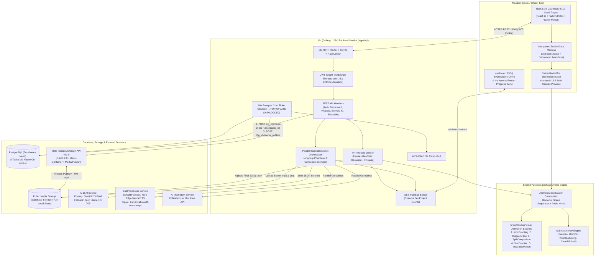
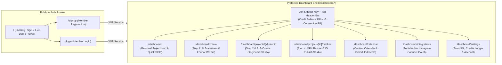
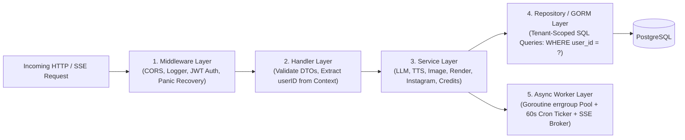
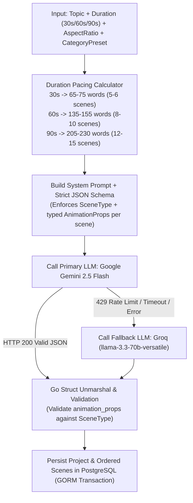
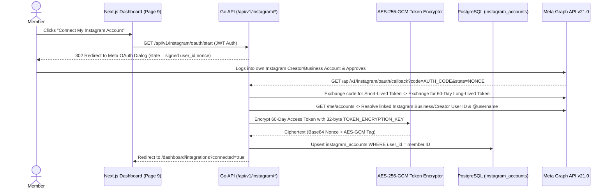
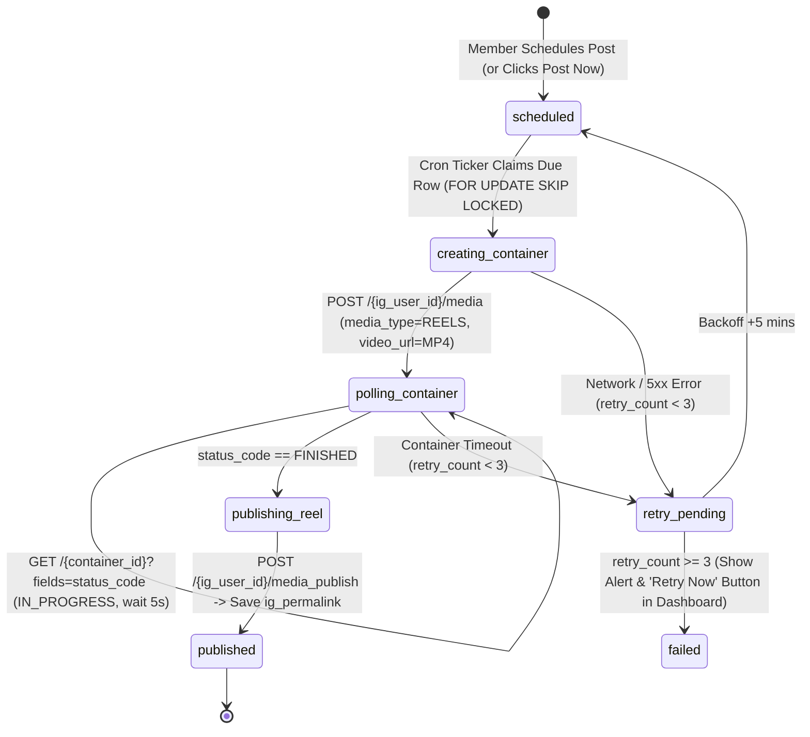
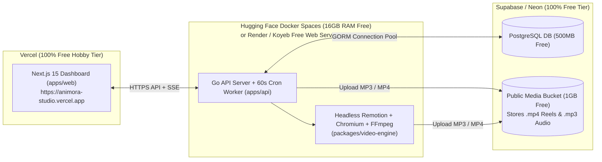

# System Design Document (SDD): Animora Studio Dashboard & AI Video Platform
**Product Name:** Animora Studio — AI Educational & Animated Video SaaS Platform  
**Document Type:** Complete End-to-End System Design Document (Frontend Dashboard, Backend API, AI/TTS Pipeline, Video Engine, Database & Instagram Scheduler)  
**Related Documents:** [PRD.md](file:///c:/Users/rk751/Projects/AI%20Video/PRD.md) • [TECHNICAL_DESIGN.md](file:///c:/Users/rk751/Projects/AI%20Video/TECHNICAL_DESIGN.md)  
**Architecture Stack:** Next.js 15 (TypeScript + Tailwind CSS + Framer Motion) • Remotion (`@remotion/player` & `@remotion/renderer`) • Go (Golang 1.23+ API & Goroutine Workers) • PostgreSQL (Native Go `GORM`) • Free-Tier Cloud & AI Stack

---

## 1. System Design Overview, Scope & Engineering Goals

### 1.1 System Purpose
**Animora Studio** is a multi-tenant SaaS dashboard and automated AI video production pipeline. It enables individual creators, educators, kids' learning channels, and brands to log into their own private dashboard, brainstorm ideas with AI, generate and edit a timed **30s, 60s, or 90s animated explainer video** (with continuous visual animations, diagrams, voiceover, and word-synced subtitles in **9:16 Vertical** or **16:9 Landscape**), render a 1080p `.mp4`, and auto-publish or schedule it directly to **their own connected Instagram account**.

### 1.2 Core Functional Requirements Covered by This Design
1. **Multi-Tenant Member Dashboard:** Private per-member workspace (`user_id` scoped), project hub, credit balance ledger, and personal Brand Kit.
2. **AI Brainstorming & Timed Storyboard Engine:** Dual-mode ideation (*Ask AI for 5 Ideas* vs. *Custom Topic*) $\rightarrow$ duration-calibrated script (`30s`, `60s`, `90s`) $\rightarrow$ structured 6–15 scene animated storyboard JSON.
3. **Interactive 3-Column Storyboard Studio:** Left scene timeline (with drag-and-drop reorder), Center 60fps live `@remotion/player` canvas (`9:16` & `16:9`), and Right 3-tab inspector (*Script & Voice*, *Animation & Diagram Props*, *Subtitles & Music*).
4. **Parallel AI Asset & Voiceover Pipeline:** Go goroutine worker pool generating scene voiceovers (**Free Edge Neural TTS** + **ElevenLabs** with automatic fallback), millisecond word timestamps, and scene illustrations concurrently with real-time Server-Sent Events (SSE) progress streaming.
5. **1080p MP4 Export & Per-Member Instagram Scheduler:** Headless Chromium + FFmpeg MP4 export to public cloud storage, 1-click Meta Instagram OAuth (**Instagram Connect**), AI social caption/hashtag generator, **"Post Now"**, and a crash-safe **60-second PostgreSQL Cron Scheduler** for the Content Calendar.

### 1.3 Non-Functional Requirements (NFRs) & Performance Targets

| Attribute | System Target | Design Mechanism |
| :--- | :--- | :--- |
| **Multi-Tenant Security** | 100% strict data & social account isolation between members | JWT `HttpOnly` cookie + Go `TenantAuthMiddleware` enforcing `WHERE user_id = ?` on all queries + AES-256-GCM encrypted OAuth tokens. |
| **Studio Preview Latency** | **< 16ms (60fps instant preview)** on any text, color, or diagram edit | Client-side React/Canvas rendering via `@remotion/player` in Next.js (**0 backend CPU cost during editing**). |
| **AI Storyboard Latency** | **< 4 seconds** for a complete 6–15 scene storyboard | Gemini 2.5 Flash with native `ResponseSchema` JSON enforcement + automatic failover to Groq (`llama-3.3-70b-versatile`). |
| **Asset Pipeline Speed** | **< 5 seconds** to synthesize voiceovers & timestamps for 10 scenes | Bounded Go Goroutine fan-out (`errgroup` with concurrency limit = 4) instead of sequential scene processing. |
| **Scheduler Reliability** | At-least-once scheduled Reel publishing with zero duplicate posts | PostgreSQL row-level locking (`SELECT ... FOR UPDATE SKIP LOCKED`) every 60s + 3x exponential backoff retry. |
| **Infrastructure Cost** | **$0.00/month** operational baseline for MVP & early users | Free-tier cloud topology (Vercel + Render/HF Docker Spaces + Supabase/Neon Postgres + Edge TTS + Gemini/Groq Free Tiers). |

---

## 2. High-Level System Architecture (HLD)

### 2.1 End-to-End Architecture Diagram



---

## 3. Dashboard Frontend System Design (`apps/web`)

### 3.1 Dashboard Sitemap & Component Architecture
The Next.js App Router frontend is structured into **3 Public/Auth Routes** and **7 Protected Member Dashboard Routes** wrapped inside a persistent `DashboardShell` layout:



### 3.2 Frontend State Management & Data Flow Design

#### A. Authentication & Multi-Tenant Session State (`AuthContext`)
* On application boot, `AuthProvider` calls `GET /api/v1/me` (passing the `HttpOnly` JWT cookie or bearer token).
* Stores `{ user, brandKit, creditBalance, instagramAccount }` in React context.
* Unauthenticated requests to `/dashboard/*` are automatically redirected to `/login` by Next.js middleware.

#### B. 3-Column Storyboard Studio State Machine (`/dashboard/projects/[id]/studio`)
The Studio page manages complex real-time editing without lag using a **Local Optimistic Store + Debounced Backend Sync** pattern:
1. **Initial Load:** Fetches `GET /api/v1/projects/:id` (project metadata + ordered `scenes[]` + `brand_kit`).
2. **Instant 60fps Preview Binding:** The `<Player component={AnimoraVideo} inputProps={{ project: localProjectState }} />` reads directly from `localProjectState`.
   * When the member edits a scene's `narration_text`, changes a flowchart node label, changes the counting target from `3` to `5`, toggles `9:16` $\leftrightarrow$ `16:9`, or switches subtitle styles (`karaoke_highlight` $\rightarrow$ `hormozi_pop`), `localProjectState` updates **synchronously in 0ms** and the Remotion `<Player />` reflects the new animation frame immediately.
3. **Debounced Auto-Save (600ms):** A background debounce hook batches scene edits and sends `PUT /api/v1/projects/:id/scenes/:sceneId` (or `PATCH /api/v1/projects/:id`) to the Go backend after 600ms of typing inactivity, displaying a subtle `"Saving... ➔ All changes saved ✓"` indicator in the top studio bar.
4. **Framer Motion Drag-and-Drop Reordering:** Reordering scene cards in the left timeline updates `order_index` locally immediately and fires `POST /api/v1/projects/:id/scenes/reorder` with `{ scene_ids: [...] }`.

#### C. Real-Time Pipeline Progress Hook (`useProjectSSE`)
When the member clicks **"Generate Voiceovers & Visuals"** or **"Render Final MP4"**, the frontend opens a persistent Server-Sent Events connection:
```typescript
// Real-time SSE event contract received by the Dashboard UI
export interface ProjectProgressEvent {
  project_id: string;
  phase: "generating_assets" | "assets_ready" | "rendering_mp4" | "render_complete" | "error";
  progress_pct: number;          // 0 to 100
  current_step_label: string;    // e.g. "Synthesizing Voiceover for Scene 4/8..."
  updated_scene_id?: string;
  used_tts_fallback?: boolean;
  fallback_notice?: string;      // e.g. "Switched to Free Edge Neural Voice (ElevenLabs quota reached)"
  output_mp4_url?: string;
  error_message?: string;
}
```

---

## 4. Go Backend Service Design (`apps/api`)

### 4.1 Layered Backend Architecture
The Go backend follows clean domain-driven layering so business logic is decoupled from HTTP transport and external AI providers:



### 4.2 Multi-Tenant Security & Authentication Design
1. **Password Security:** Passwords are hashed using `bcrypt.GenerateFromPassword(password, 12)` (`cost = 12`). Plaintext passwords are never logged or stored.
2. **JWT Token Issuance:**
   * Payload claims: `{ "sub": user.ID.String(), "email": user.Email, "exp": time.Now().Add(7 * 24 * time.Hour).Unix() }`.
   * Signed with `HMAC-SHA256` (`JWT_SECRET`).
   * Delivered both as an `HttpOnly; Secure; SameSite=Lax` cookie (`animora_token`) and in the JSON login response for flexible client handling.
3. **Strict Tenant Isolation Rule:**
   * `AuthMiddleware` parses the JWT and injects `ctx = context.WithValue(r.Context(), UserIDKey, userUUID)`.
   * Every database query on `projects`, `brand_kits`, `renders`, `instagram_accounts`, `scheduled_posts`, and `credit_ledger` **must** include `.Where("user_id = ?", currentUserID)`.
   * Child `scenes` queries join or verify ownership against `projects.user_id = currentUserID` before any read or write.

### 4.3 AI Brainstorming & Structured Storyboard Service (`internal/services/llm`)



### 4.4 Parallel Goroutine Asset Orchestrator & Dual-TTS Failover (`internal/services/tts`)
When `POST /api/v1/projects/:id/generate-assets` is called:
1. The handler marks `project.status = "generating_assets"` and immediately returns `202 Accepted` while launching the background orchestrator goroutine.
2. The orchestrator creates an `errgroup.WithContext(ctx)` with `g.SetLimit(4)` (up to 4 scenes processed simultaneously):
   * **Step A — Voiceover Synthesis & Word Timestamps:**
     * If `project.VoiceProvider == "elevenlabs"` and `ELEVENLABS_API_KEY` is configured:
       * Calls `POST https://api.elevenlabs.io/v1/text-to-speech/{voice_id}/with-timestamps`.
       * If ElevenLabs succeeds, extracts `.mp3` bytes and aggregates character start/end times into word-level `[]WordTimestamp`.
       * **Automatic Failover:** If ElevenLabs returns `401/403/429` (free quota exhausted or cloud IP blocked), catches the error, logs a fallback notice, and immediately calls `EdgeTTSProvider.Synthesize(...)`.
     * If `project.VoiceProvider == "edge_tts"` (or on fallback):
       * Connects to Microsoft Edge Neural TTS (`en-US-AnaNeural` for kids, `en-US-ChristopherNeural` / `en-US-AriaNeural` for explainers, `en-IN-NeerjaNeural` for Indian English) and captures the `.mp3` stream + `WordBoundary` events (`{ word, start_ms, end_ms }`).
   * **Step B — Dynamic Scene Duration Alignment:**
     * Updates `scene.DurationMs = lastWordEndMs + 450` (450ms natural breathing pause at the end of each scene) so the Remotion animation duration matches the spoken audio without ever cutting off a sentence.
   * **Step C — Scene Visuals (When Required):**
     * For `illustrated_motion` scenes where the user requests an AI illustration, generates the illustration via **Pollinations Flux** (`https://image.pollinations.ai/prompt/{url_encoded_prompt}?width={w}&height={h}&model=flux&nologo=true`).
   * **Step D — SSE Progress Broadcast:**
     * Saves the updated scene in PostgreSQL and publishes `{ phase: "generating_assets", progress_pct: completed * 100 / total }` to the project's SSE channel.

---

## 5. Video, Animation & Subtitle Engine Design (`packages/video-engine`)

### 5.1 Master Composition & Continuous Visual Flow Architecture
To ensure every rendered video looks like a **continuously flowing animated explainer video** (and never like static PowerPoint text boxes), each of the 5 templates inside `packages/video-engine` combines **structured educational labels** with **continuous 60fps/30fps animated physics & visual motion**:

| Template ID | Continuous Visual Motion Rendered on Every Frame | Dynamic Data Bound from `animation_props` |
| :--- | :--- | :--- |
| **`kids_counting`** | • Floating background geometry & rotating sparkles<br>• Bouncy spring entrance for Hero Letter/Number (`A`–`Z`, `1`–`20`)<br>• **Timestamp-Synced Pop-In:** Each object (`🍎`, `⭐`, `🐶`) pops in with a spring bounce at the exact millisecond the voiceover counts that number, followed by a confetti celebration burst. | `mode`, `focus_symbol`, `phonetic_word`, `target_count`, `item_label`, `item_emoji`, `pop_trigger_ms` |
| **`diagram_flow`** | • Progressive node-by-node entrance synced to scene progress<br>• **Animated Flow Particles & Arrows:** Glowing energy particles travel continuously along the connecting arrows (`Node 1 ➔ Node 2 ➔ Node 3`) while the currently narrated step pulses (`1.04x` sine wave) with an accent glow. | `flow_direction`, `nodes: [{ id, title, subtitle, icon }]` |
| **`split_comparison`** | • Spring slide-in of Left/Top Card (`✗ Myth` / `DC Power`) during first half of narration<br>• Pivot transition at scene midpoint revealing Right/Bottom Card (`✓ Fact` / `AC Power`) with live animated waveform / comparison visual indicator. | `left_or_top_card`, `right_or_bottom_card` |
| **`stat_counter`** | • **Interpolated Number Ticker:** Smoothly counts from `0` to `target_number` (`0% ➔ 87%`)<br>• **Spring-Animated Bar Chart:** Bars grow upward with spring damping while value counters increment above each bar. | `display_mode`, `target_number`, `number_prefix`, `number_suffix`, `takeaway_label`, `bars` |
| **`illustrated_motion`** | • **60fps Ken Burns Camera Rig:** Continuous smooth `interpolate()` zoom-in, zoom-out, or horizontal pan across custom AI illustrations or animated SVG vector stages (rotating solar rays, flying photon particles, circuit loops) + floating glassmorphic callout pill. | `art_style`, `camera_motion`, `callout_badge`, `image_url` |

### 5.2 Dual-Layer Captions & Subtitles Engine
1. **On-Video Word-Synced Subtitles (`SubtitleOverlay.tsx`):**
   * Reads `currentMs = (frame / fps) * 1000` on every frame.
   * Partitions `scene.word_timestamps` into 4-word chunks (for `9:16`) or 6-word chunks (for `16:9`).
   * Renders the active chunk in one of **4 selectable styles** (`karaoke_highlight`, `hormozi_pop`, `kids_read_along`, `clean_minimal`), highlighting and spring-scaling the exact word where `word.start_ms <= currentMs <= word.end_ms`.
2. **AI Instagram Post Caption & Hashtag Generator:**
   * Executed on Page 7 (`POST /api/v1/projects/:id/generate-caption`).
   * Sends the full assembled video script + selected tone (*Educational*, *Kids/Parent Friendly*, *Viral Hook*, *Professional*) to Gemini/Groq and returns `{ caption_text, hashtags[], character_count }`.

---

## 6. Per-Member Instagram Connect & Content Calendar Scheduler Design

### 6.1 Per-Member OAuth 2.0 & AES-256-GCM Token Vault
Every member connects **their own** Instagram Professional (Creator or Business) account:



### 6.2 Crash-Safe 60-Second Go Cron Worker & Reels Publishing State Machine
Whether a member clicks **"Post to Instagram Now"** or **"Schedule for Later"** on the Content Calendar, the publishing state machine transitions through:

`scheduled` $\rightarrow$ `creating_container` $\rightarrow$ `polling_container` $\rightarrow$ `publishing_reel` $\rightarrow$ `published` *(or `retry_pending` $\rightarrow$ `failed`)*



---

## 7. Database Design, Indexes & Storage Rules (PostgreSQL + `GORM`)

### 7.1 Table Summary & Multi-Tenant Indexing Strategy

| Table Name | Primary Key | Tenant Isolation Key | High-Performance Indexes | Purpose |
| :--- | :--- | :--- | :--- | :--- |
| **`users`** | `id (UUID)` | Self (`id`) | `UNIQUE (email)` | Member credentials, profile name, and current `credit_balance` (starts at `15`). |
| **`brand_kits`** | `id (UUID)` | `user_id (UUID)` | `UNIQUE (user_id)` | Member's default primary/accent hex colors, font family, logo URL, and default voice engine. |
| **`projects`** | `id (UUID)` | `user_id (UUID)` | `INDEX (user_id, created_at DESC)` | Video project metadata, duration (`30/60/90`), aspect ratio (`9:16`/`16:9`), `caption_config JSONB`. |
| **`scenes`** | `id (UUID)` | Via `project_id` | `INDEX (project_id, order_index ASC)` | Ordered storyboard scenes, narration, `scene_type`, `animation_props JSONB`, `word_timestamps JSONB`. |
| **`renders`** | `id (UUID)` | `user_id (UUID)` | `INDEX (project_id, created_at DESC)` | MP4 export jobs, live progress percentage, public `.mp4` URL, cover thumbnail URL. |
| **`instagram_accounts`** | `id (UUID)` | `user_id (UUID)` | `UNIQUE (user_id)` | Member's connected `@ig_username`, `ig_user_id`, AES-256-GCM encrypted OAuth token, expiry date, or Sandbox Mock flag. |
| **`scheduled_posts`** | `id (UUID)` | `user_id (UUID)` | `INDEX (status, scheduled_for ASC)`<br>`INDEX (user_id, scheduled_for DESC)` | Content calendar entries, post caption/hashtags, scheduled timestamp, IG container/media IDs, live permalink, retry count. |
| **`credit_ledger`** | `id (UUID)` | `user_id (UUID)` | `INDEX (user_id, created_at DESC)` | Immutable audit trail of starter credit grants (`+15`) and MP4 render deductions (`-1`, `-2`, `-3`). |

---

## 8. Complete REST API & Payload Contract Between Next.js and Go

### 8.1 Standard JSON Response & Error Envelope
All Go API responses follow a consistent JSON structure:
```json
// Success Envelope (HTTP 200 / 201)
{
  "success": true,
  "data": { ... }
}

// Error Envelope (HTTP 400 / 401 / 403 / 404 / 422 / 500)
{
  "success": false,
  "error": {
    "code": "INSUFFICIENT_CREDITS",
    "message": "Rendering a 90-second video requires 3 credits, but your balance is 1 credit."
  }
}
```

### 8.2 Key Endpoint Payload Contracts

#### 1. `POST /api/v1/ai/brainstorm` (Step 1: Generate 5 Video Ideas)
* **Request:**
  ```json
  {
    "niche_or_topic": "How Solar Energy Works for Homeowners",
    "category_preset": "technical_explainer",
    "target_duration_sec": 60
  }
  ```
* **Response (`200 OK`):**
  ```json
  {
    "success": true,
    "data": {
      "provider_used": "gemini-2.5-flash",
      "ideas": [
        {
          "title": "How Solar Panels Turn Sunlight Into Home Electricity",
          "hook_line": "Ever wondered how a silent glass panel on your roof can power your air conditioner using only photons?",
          "visual_concept": "3-Layer silicon cell diagram + 4-step photovoltaic electron flowchart + DC vs AC wave comparison",
          "recommended_preset": "technical_explainer"
        }
      ]
    }
  }
  ```

#### 2. `POST /api/v1/projects` (Step 1 $\rightarrow$ Step 2: Create Project & Generate Multi-Scene Storyboard)
* **Request:**
  ```json
  {
    "title": "How Solar Panels Turn Sunlight Into Electricity",
    "topic_prompt": "Explain how silicon solar cells convert photons into DC current and how the inverter converts it to AC power for a home.",
    "category_preset": "technical_explainer",
    "target_duration_sec": 60,
    "aspect_ratio": "9:16",
    "voice_provider": "edge_tts",
    "voice_id": "en-US-ChristopherNeural",
    "voice_speed": 1.0
  }
  ```
* **Response (`201 Created`):** Returns the created `Project` object populated with `8 ordered Scene rows`, each containing validated `scene_type` and `animation_props`.

#### 3. `POST /api/v1/publish/instagram` (Step 4: Instant Publish or Schedule to Calendar)
* **Request:**
  ```json
  {
    "project_id": "d290f1ee-6c54-4b01-90e6-d701748f0851",
    "render_id": "f47ac10b-58cc-4372-a567-0e02b2c3d479",
    "caption": "Ever wondered how sunlight turns into 240V AC electricity for your home? ☀️⚡\n\n1️⃣ Photons strike N/P silicon layers\n2️⃣ Electrons flow as DC power\n3️⃣ Solar inverter converts DC to 60Hz AC!\n\nSave this explainer for later! #SolarEnergy #ScienceExplained #CleanTech #HowItWorks",
    "mode": "schedule",
    "scheduled_for": "2026-11-25T18:00:00+05:30",
    "timezone": "Asia/Kolkata"
  }
  ```
* **Response (`200 OK`):** Returns the `ScheduledPost` record (`status: "scheduled"` or `"published"` with `ig_permalink`).

---

## 9. Deployment Topology & Free-Tier Production Blueprint



### 9.1 Production Readiness & Fault-Tolerance Checklist
* **Zero-Key Out-of-the-Box Local Mode:** If a developer runs the project locally before setting up external API keys, the Go backend automatically enables:
  1. **Rule-Based Smart Storyboard Generator Fallback** (if neither `GEMINI_API_KEY` nor `GROQ_API_KEY` is set yet) so you can still create and edit any topic storyboard immediately.
  2. **100% Free Microsoft Edge Neural TTS** (requires no API key).
  3. **Local Static Media Storage (`/uploads/*` served by Go)** if Supabase/R2 credentials are not set yet.
  4. **Instagram Sandbox Mock Publisher** so you can test connecting an Instagram handle, posting immediately, and scheduling Reels on the Content Calendar locally end-to-end.
